<!-- Every card is an animated SVG drawn by scripts/render_readme_cards.py and refreshed daily
     by .github/workflows/update-profile-art.yml. Design: "Three Worlds", paper & ink aesthetic.
     Spacing is baked into the SVGs, so keep this block free of blank lines and keep the cards in
     a row on one line with no spaces between them. -->

 
 
 
 
<picture><source media="(prefers-color-scheme: dark)" srcset="./cards/title-coding-dark.svg" /></picture> 

<a href="https://sagarithm.in">sagarithm.in</a> &nbsp;/&nbsp; <a href="https://x.com/thesagarithm">x (twitter)</a> &nbsp;/&nbsp; <a href="https://github.com/sagarithm">github</a> &nbsp;/&nbsp; <a href="mailto:sagarithm@gmail.com">email</a>

